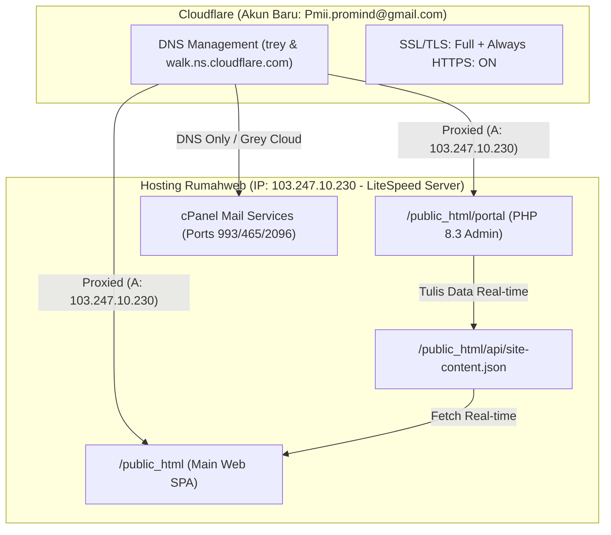

# PROMIND — Project & Infrastructure Handover Document

> **Dokumen Handover Komprehensif untuk Agent AI / Developer Selanjutnya**  
> *Tanggal Update Terakhir*: 28 Oktober 2026  
> *Repositori Git*: `https://github.com/thesantoso/promind-company-profile.git` (Branch: `main`)

---

## 1. Identitas Brand & Aturan Konten

- **Perusahaan**: PT Properti Manajemen Inovasi Indonesia
- **Brand**: **`PROMIND`** (Wajib huruf kapital penuh).
- **Core Business**: Manajemen Properti Komersial, High-Rise Office Tower, Apartemen Mewah, Mall, dan Kawasan Industri Terpadu (Building Management, M&E Engineering, Tenancy, Tenant Relations, HSE, dan Property Audit).
- **Aturan Brand Ketat**:
  - **DILARANG** mencantumkan nama pihak ketiga atau brand lama seperti **"Indoland"** atau **"PROAPPS"** pada copywriting/UI publik. Seluruh identitas adalah murni milik **PROMIND**.
  - Font resmi: **Manrope** (Headings / Display) dan **DM Sans** (Body text).
  - Header navigasi: **Wajib Solid Natural White `#ffffff` 100%** (tidak boleh blur/transparan baik saat di atas maupun saat di-scroll).
  - Gaya visual: **Strict Anti-"AI Slop"** (Dilarang menggunakan badge angka menyala dalam kotak `01`/`02`, kartu mengambang berlebihan, atau form bertumpuk). Gunakan bullet dot (`•`) untuk daftar kualifikasi/tanggung jawab.

---

## 2. Peta Domain & Infrastruktur Live

Sistem telah sepenuhnya dilepas dari Cloudflare Workers lama (`thesantoso`) dan kini berjalan di infrastruktur mandiri perusahaan:



### URL Resmi:
| Layanan | URL | Keterangan |
|---|---|---|
| **Website Utama** | [https://promind.co.id](https://promind.co.id) | React SPA + Vite, LiteSpeed `.htaccess` rewrite |
| **Email Webmail** | [https://webmail.promind.co.id](https://webmail.promind.co.id) | Direct cPanel Webmail (Roundcube) |
| **Admin Operations Portal** | [https://portal.promind.co.id](https://portal.promind.co.id) | Native PHP 8.3 Dashboard mandiri |
| **cPanel Hosting** | [https://cpanel.promind.co.id](https://cpanel.promind.co.id) | Panel Hosting Rumahweb (User: `prom9466`) |

---

## 3. Detail Dashboard Admin (`portal.promind.co.id`)

- **Teknologi**: Native PHP 8.3 (tanpa framework berat, eksekusi instan di LiteSpeed).
- **Lokasi File**: `/public_html/portal` (di repo: `public/portal/`).
- **Kredensial Default**:
  - **Username**: `admin`
  - **Password**: `Promind2026!` *(Bcrypt hash tersimpan di `portal/config.php`)*
- **Fitur**:
  1. **Lowongan Karir (Careers)**: Tambah, edit, hapus lowongan karir aktif (judul, departemen, deskripsi, tanggung jawab, kualifikasi, benefit, email penerimaan CV).
  2. **Info Kontak & HQ**: Alamat kantor Mangkuluhur City, nomor WhatsApp, nomor telepon, dan email resmi.
  3. **Mode Pemeliharaan (Maintenance Mode)**: Toggle 1-klik untuk mengaktifkan/menonaktifkan maintenance page publik.
  4. **Keamanan**: Anti-CSRF token per sesi, proteksi `.htaccess` agar file konfigurasi dan data tidak bisa diunduh langsung dari browser.
- **Mekanisme Sinkronisasi**:
  Ketika admin menyimpan perubahan di portal, PHP langsung mengupdate `/public_html/api/site-content.json`. Website publik `https://promind.co.id` membaca data tersebut secara real-time.

---

## 4. Alur CI / CD & Deployment Otomatis

Repositori aktif: **`https://github.com/thesantoso/promind-company-profile.git`**  
Workflow: [`.github/workflows/deploy.yml`](file:///.github/workflows/deploy.yml)

### Alur Kerja:
1. Setiap kali ada `git push` ke branch `main`, GitHub Actions otomatis aktif.
2. Runner menjalankan `npm install` dan `npm run build`.
3. Action `SamKirkland/FTP-Deploy-Action@v4.3.5` langsung mengunggah isi folder `dist/` ke `/public_html` di server Rumahweb via FTP.

### Secrets yang Dikonfigurasi di GitHub Settings:
- `FTP_SERVER`: `103.247.10.230`
- `FTP_USERNAME`: `prom9466`
- `FTP_PASSWORD`: *(Kredensial password cPanel Rumahweb)*

---

## 5. Ringkasan File & Folder Proyek

```
promind-company-profile/
├── .github/workflows/deploy.yml     # Workflow CI/CD otomatis ke FTP
├── .gitignore                       # Mengabaikan node_modules, dist, .DS_Store
├── AGENTS.md                        # Single source of truth untuk AI Agent
├── index.html                       # Root HTML (Preconnect font Manrope & DM Sans)
├── package.json                     # Scripts build: vite build
├── public/
│   ├── .htaccess                    # Rewrite rules LiteSpeed, force HTTPS, browser cache
│   ├── styles-exact.css             # High-precision editorial CSS (Solid white header)
│   ├── api/site-content.json        # Snapshot data konten awal (careers, hero, kontak)
│   ├── images/                      # Asset foto gedung & operasional
│   └── portal/                      # Native PHP 8.3 Admin Dashboard
│       ├── .htaccess                # Shield untuk file internal
│       ├── config.php               # Auth config & Bcrypt password hash
│       └── index.php                # Aplikasi admin portal lengkap
└── src/
    ├── App.jsx                      # Root SPA router (Clean URLs + Hash fallback)
    ├── components/                  # Navbar, Footer, HeroSlider, dsb.
    ├── data/promindContent.js       # Konten statis fallback
    └── react-pages/                 # Halaman: HomePage, ServicesPage, CareersPage, etc.
```

---

## 6. Panduan untuk Agent AI Berikutnya

1. **Jika Ingin Mengubah Konten Statis**:
   - Anda bisa mengeditnya di `src/react-pages/` atau langsung melalui Admin Portal di `https://portal.promind.co.id`.
2. **Jika Ingin Menambah Halaman / Fitur Baru**:
   - Jalankan `npm run build` lokal untuk memastikan tidak ada error bundle.
   - Lakukan `git push origin main`, GitHub Actions akan otomatis mendeploy perubahan ke server Rumahweb dalam waktu ~40 detik.
3. **Peringatan Keamanan**:
   - Jangan pernah melakukan commit file yang berisi token Cloudflare atau password plaintext ke dalam repositori publik (Push Protection akan memblokir).
